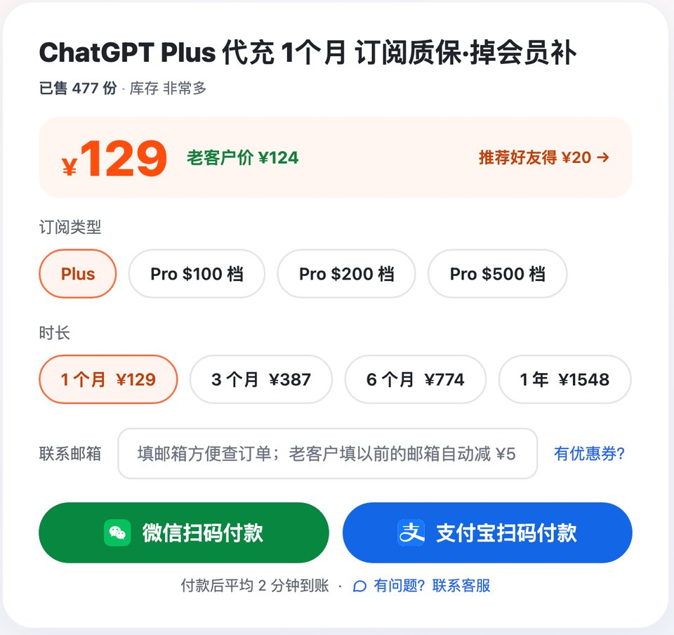
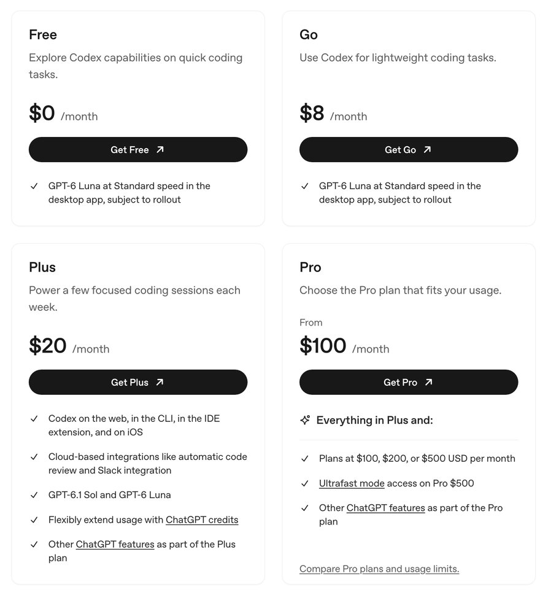
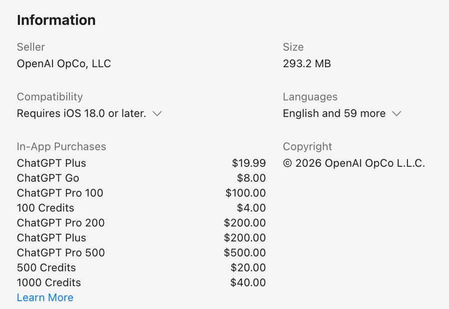

# ChatGPT价格表 2026：Plus 多少钱一个月、各地区官方价和国内价

> 2026-10-30 更新 · 瑶瑶ai训练师（kw.yaoyao.chat 店主）整理 · 文中商城链接为广告

**先说结论：** 国内开 Plus，瑶瑶ai训练师的商城是 [ChatGPT Plus 一个月 ¥129](https://kw.yaoyao.chat/item/5?utm_source=github&utm_medium=readme&utm_campaign=jiage&utm_content=top)，标多少付多少，不用另算税；3 个月到 1 年都按 ¥129 乘月数。支付宝、微信付，平均 2 分钟到账，不要密码和验证码，开不成重提或退款；全站近 30 天开通 402 单。下单填券码 **888888** 再减 ¥3。

- **ChatGPT Plus 多少钱**：官方网页标价 20 美元一个月，Go 8 美元、Pro 100 / 200 / 500 美元，都不含税；Plus 和 Pro 只能按月付。
- **App 里的 GPT会员价格分地区**：Plus 美国区 19.99 美元、日本区 3,000 日元、英国区 19.99 英镑、台湾区 690 新台币；香港、大陆区的 App Store 没有 ChatGPT。13 个区全表见下。
- **谁不用买**：人在支持地区、有扣得了款的卡，自己订就行，记得算税；拿不准会不会每月都用的，先买 1 个月。

*图：瑶瑶商城下单区，四个时长的价格并排列着（kw.yaoyao.chat/item/5，2026-10-30 截图）*

## ChatGPT价格：官方各档月费（2026-10-30 核对）

| 档位 | 官方月费 | 怎么计费 | 出处 |
|---|---|---|---|
| 免费版 | 0 美元 | — | 定价页 |
| Go | 8 美元 | 按月 | 定价页 |
| Plus | 20 美元 | 只能按月付，没有年付，不能预付几个月 | 定价页；What is ChatGPT Plus? |
| Pro | 100 / 200 / 500 美元 | 只能按月付 | 定价页；帮助中心 Pro 套餐说明 |
| Business（团队，2 人起） | 每人 20 美元（按年付）/ 25 美元（按月付） | 按人头 | 定价页 |
| Enterprise、Edu | 官网不标价，找销售谈 | — | 定价页 |

- 定价页指 OpenAI 的 [Pricing · ChatGPT Learn](https://learn.chatgpt.com/docs/pricing)；"只能按月付"出自帮助中心《What is ChatGPT Plus?》和 Pro 套餐说明。三处都是 2026-10-30 当天打开核对的。
- 这张表只放美元原价，不替官方换算人民币：汇率天天在变，税和手续费也因人而异，换出来的数字反倒容易误导人。
- Pro 三档在用量上差在哪，这页不展开，只记价格。

Business 是团队版，最少 2 个人。年付每人每月 20 美元，跟 Plus 一个价，多出来的是管理后台、单点登录这类团队功能，官方还写明默认不拿企业数据训练模型；按月付每人每月 25 美元。3 个人按年付，每月就是 60 美元。只有你一个人用，Plus 就够了。

*图：OpenAI 官方定价页截图（learn.chatgpt.com/docs/pricing，2026-10-30）：Free 0、Go 8、Plus 20、Pro 100 美元起*

## 各地区 gpt会员价格：13 个区的 App Store 标价（2026-10-30）

很多人想知道"日本区多少钱""港区会不会便宜"。下面是 2026-10-30 当天逐个打开 App Store 各区的 ChatGPT 页面，从"App 内购买项目"里抄下来的标价，只写当地货币，不做折算。每一行最后一格就是那个区的页面。

| 地区 | 货币 | Go | Plus | Pro 100 | Pro 200 | Pro 500 | 出处 |
|---|---|---|---|---|---|---|---|
| 美国 | 美元 | 8 | 19.99 | 100 | 200 | 500 | [apps.apple.com/us](https://apps.apple.com/us/app/chatgpt/id6448311069) |
| 日本 | 日元 | 1,400 | 3,000 | 16,800 | 30,000 | 84,000 | [apps.apple.com/jp](https://apps.apple.com/jp/app/chatgpt/id6448311069) |
| 韩国 | 韩元 | 13,000 | 29,000 | 159,000 | 299,000 | 790,000 | [apps.apple.com/kr](https://apps.apple.com/kr/app/chatgpt/id6448311069) |
| 台湾 | 新台币 | 270 | 690 | 3,300 | 6,990 | 16,500 | [apps.apple.com/tw](https://apps.apple.com/tw/app/chatgpt/id6448311069) |
| 新加坡 | 新加坡元 | 10.98 | 29.98 | 137.98 | 299.98 | 689.98 | [apps.apple.com/sg](https://apps.apple.com/sg/app/chatgpt/id6448311069) |
| 马来西亚 | 林吉特 | 23.99 | 99.90 | 419.90 | 999.90 | 2,099.90 | [apps.apple.com/my](https://apps.apple.com/my/app/chatgpt/id6448311069) |
| 菲律宾 | 比索 | 300 | 999 | 6,490 | 9,990 | 32,490 | [apps.apple.com/ph](https://apps.apple.com/ph/app/chatgpt/id6448311069) |
| 印度 | 卢比 | 399 | 1,999 | 10,699 | 19,900 | 52,900 | [apps.apple.com/in](https://apps.apple.com/in/app/chatgpt/id6448311069) |
| 土耳其 | 里拉 | 249.99 | 999.99 | 5,299.99 | 9,999.99 | 26,499 | [apps.apple.com/tr](https://apps.apple.com/tr/app/chatgpt/id6448311069) |
| 英国 | 英镑 | 6.99 | 19.99 | 88.90 | 200 | 444.99 | [apps.apple.com/gb](https://apps.apple.com/gb/app/chatgpt/id6448311069) |
| 德国 | 欧元 | 7.99 | 22.99 | 102.99 | 229 | 509.99 | [apps.apple.com/de](https://apps.apple.com/de/app/chatgpt/id6448311069) |
| 加拿大 | 加元 | 12.99 | 24.99 | 152.99 | 249 | 759.99 | [apps.apple.com/ca](https://apps.apple.com/ca/app/chatgpt/id6448311069) |
| 澳大利亚 | 澳元 | 13 | 29.99 | 154.99 | 300 | 769.99 | [apps.apple.com/au](https://apps.apple.com/au/app/chatgpt/id6448311069) |
| 香港、中国大陆、澳门 | — | 没上架 | 没上架 | 没上架 | 没上架 | 没上架 | [hk](https://apps.apple.com/hk/app/chatgpt/id6448311069) / [cn](https://apps.apple.com/cn/app/chatgpt/id6448311069) / [mo](https://apps.apple.com/mo/app/chatgpt/id6448311069) 均为 404 |

*图：美国区 App Store 的 ChatGPT 页面，展开"App 内购买项目"后的标价，对应上表第一行（apps.apple.com/us/app/chatgpt/id6448311069，2026-10-30 截图）*

看这张表，有几件事要知道：

- **香港、大陆、澳门查不到价**。这三个区的 ChatGPT 页面打开都是 404；OpenAI 帮助中心公布的 ChatGPT 支持地区名单里，也没有这三个地方。网上说的"港区 Plus 价"，找不到出处。
- **同一个数字，单位可能不一样**。英国区 Plus 跟美国区一样写 19.99，单位却是英镑；台湾区写 690，是新台币。各区价格是按当地定的，不是拿 20 美元按当天汇率换出来的。
- **网页订也按当地货币结**。帮助中心《Multi-currency billing》写着，chatgpt.com 上的订阅按当地货币结算，列了 67 种货币，有日元、韩元、新台币、新加坡元、里拉、卢比、英镑、欧元，没有人民币和港币。具体金额看结算页。
- **付款方式也分地方**。同一篇里，信用卡、借记卡哪儿都能用；印度另有 UPI（只限 Go 和 Plus），韩国有 Kakao Pay、Naver Pay，菲律宾有 GCash。名单里没有支付宝和微信支付。
- **这张表是拿来看懂标价的，不是教你换区**。App 里能不能订，要看 Apple ID 的地区和付款方式，别为了便宜去填假资料。

## chatgpt订阅价格含不含税和手续费

官方写的 20 美元只是标价，不等于你卡上最后被扣的数。自己订，还可能多出三块：

1. **税**。网页标价不含税，一些国家和地区结账时会加增值税或销售税。日本就是一例：官方写明从 2025 年 1 月 1 日起，直接向 OpenAI 购买的人要付 10% 消费税，页面上照样标美元。最后多少，看结算页。
2. **货币转换费**。拿人民币卡付外币，发卡行可能另收一笔转换费。何况国内发的卡，大多在付款这一步就被拒了。
3. **商店价**。在手机 App 里订，按上面那张表的当地标价扣钱，由 Apple 或 Google 结算，跟网页订阅是两套账。

所以拿国内价跟官方价比，别只拿 20 美元去比，官方那头还挂着税和手续费，最后扣多少要等结算页出来。瑶瑶店里就简单了：下单页显示多少就付多少；要发票能开，也能对公转账。

## 看 GPT Plus 价格时最容易算错的几处

很多人比价只盯着一个数字，结果吃了亏。最常见的是这几处：

- **把 API 价当会员价**。OpenAI 网站上还有一套按百万 Token 计的 API 价格，那是开发者接口的账单，跟 Plus 月费是两码事，开了 Plus 也不会多出 API 余额。
- **以为有年卡能便宜**。个人 Plus 和 Pro 官方都只有月付，帮助中心写明 Plus 不支持年付、不能预付几个月。App Store 内购列表里另有一项也叫 ChatGPT Plus，标价跟 Pro 200 一模一样（美国区 200 美元、日本区 30,000 日元），页面没说它是什么，别看名字就当成年卡。看到"年付折扣"，多半说的是 Business，或者卖家自己的套餐。
- **把 Credits 当会员**。美国区列表里还有 100 / 500 / 1000 Credits，标 4 / 20 / 40 美元。官方定价页说，Plus、Pro 用户额度用完可以买 credits 接着用，不用升级套餐。它是加购的用量，不是月费，买了还是原来那一档。
- **网页、App 各付一份**。网页订了又在 App 里订，就是两份钱，官方不会自动退掉其中一份，得自己去取消。
- **只比单价不比售后**。同样一个月，开不成退不退、中途掉了补不补、找不找得到人，差出来的钱可能比单价差还多。
- **没看见"起"字和附加费**。有的页面写"起"，下单才发现要加服务费、发票费。比价之前，先确认页面价就是全部要付的钱。

## 国内买 chatgpt plus多少钱：支付宝、微信付的人民币价

下面是瑶瑶ai训练师商城的价格，2026-10-30 03:59 从商城数据库导出，最后以下单页为准：

| 商品 | 价格 | 折到每月 | 怎么开通 |
|---|---|---|---|
| Plus 1 个月 | ¥129 | ¥129 | 付款后发卡密，自己提交，平均 2 分钟到账 |
| Plus 3 个月 | ¥387 | ¥129 | 同一个下单页选"3 个月"，付款后页面直接显示 3 张卡密，每张 1 个月，到期再用下一张，不用每月下单 |
| Plus 6 个月 | ¥774 | ¥129 | 同一个下单页选"6 个月"，给 6 张卡密，用法和 3 个月一样 |
| Plus 1 年 | ¥1,548 | ¥129 | 付款后在订单页填信息，12 个月一次开好 |
| Pro 100 / 200 / 500 美金档位，各 1 个月 | ¥699 / ¥1,399 / ¥3,499 | — | 订单页填好信息，平均 2 分钟开通 |

表里最容易被忽略的是最后一列：1 年和 Pro 是付款后在订单页填信息，跟 1 个月、3 个月、6 个月发卡密、自己提交的流程不一样，别弄混。

价格之外，下面这几条也该算进"花多少钱"里：

- 每一单都开到你本人的账号，密码和验证码一样都不用给。
- 开不成可以重提或退款；开成以后在本期内被收回会员，再补一个月；封号不在保障范围内。
- 老客户每单减 ¥5（下单填以前买过的邮箱），跟券码、推荐码不同时用。

## chatgpt会员多少钱一年：按年还是按月更省

很多人第一反应是"买得越久越便宜"，放在 ChatGPT 这儿不成立。

**官方那边没得选。** Plus 和 Pro 都只能按月付，不能年付，也不能一口气预付几个月。自己订一整年 Plus，就是 20 × 12 = 240 美元，再加上税。

**店里的长档也不打折。** 1 年 ¥1,548 正好是 ¥129 × 12，3 个月、6 个月也是这么乘出来的。多买几个月，换来的是"不用每月下单"和"价格先锁住"，不是折扣。

真能省下钱的，是下面这几件事：

| 做法 | 省在哪 | 说明 |
|---|---|---|
| 不用的月份不买 | 那个月的 ¥129 | 代充不会自动续费，放假、出差用不上就停 |
| 按月回购用老客户价 | 每单 ¥5 | 每个月都是一单，每单都能减；一次买 1 年只算一单，只减一次 |
| 第一单用券码（见开头） | ¥3 | 不和老客户减 ¥5、推荐码同时用 |

照这么算，一年里每个月都会用、又不嫌每月操作一次麻烦的人，按月买反而最划算；图省事、怕忘了续、想把价格锁住的，选 1 年。第一次买、还拿不准会用多勤的，先买 1 个月。以后可能升到 Pro 的，也按月买，换档方便。

按月回购还有个小细节：会员没到期就急着提交下个月的卡密，充值页会提示"已有订阅"。这种情况不扣钱，卡密也给你留着，等这一期到期以后再提交就行。

## 价格变动记录

| 时间 | 变化 | 依据 |
|---|---|---|
| 2023 年 | Plus 推出，官方每月 20 美元，此后标价没动过 | 商城教程页整理 |
| 2025-01-01 | 日本开始对直接向 OpenAI 购买的用户收 10% 消费税，标价仍写美元 | 帮助中心《The Japanese Consumption Tax on your OpenAI Invoices》 |
| 2025 年 | Go 先在印度等部分国家上线 | 商城教程页整理 |
| 2026 年 1 月 | Go 扩到更多国家和地区，美国定价每月 8 美元 | OpenAI《Introducing ChatGPT Go》 |
| 2026 年 9 月底 | Pro 按价格分成 100 / 200 / 500 美元三档；Pro 200 价格不变、宣布新订阅额度变少（10-29 已取消） | 帮助中心 Pro 套餐说明 |
| 2026-10-26 | GPT-6.1 Terra 发布，官方没有调整订阅价 | Introducing GPT-6.1 Terra；发布说明 |
| 2026-10-28 | 商城 Plus 3 个月、6 个月、1 年统一按 ¥129 乘月数（¥387 / ¥774 / ¥1,548），并进一个月的同一个下单页 | 商城价格记录 |
| 2026-10-29 | 官方取消 9 月底宣布的 Pro 200 降额，新开和老用户同一额度；Pro 100、Pro 500 的 Work 和 Codex 额度翻倍；三档月费和 Plus 都没变 | ChatGPT 发布说明 2026-10-29 条目；帮助中心 About ChatGPT Pro tiers |
| 2026-10-30 | 复核：网页标价免费版 0、Go 8、Plus 20、Pro 100 / 200 / 500 美元；App Store 13 个区的五档标价见上表，香港、大陆、澳门区仍没有 ChatGPT；商城价格没有变化 | 官方定价页；App Store 各区页面；商城事实卡 |
| 2026-10-31 截止 | 2026 年返校季学生优惠：美国高校在读生经 SheerID 验证，Plus 免费 4 个月，之后每月 20 美元；App Store、Google Play 扣费的订阅不能用 | 帮助中心 ChatGPT Back to School offer for students |

这张表的用处是：网上看到"涨价了""降价了"的说法，先对一下时间和出处。官方价格会变，店里的售价也会跟着汇率调。下单前，以官方结算页和商城下单页当时显示的为准；这张表每核对一次就补一行。

想把价格先锁住的，可以直接看 [gpt会员价格：3 个月 ¥387](https://kw.yaoyao.chat/item/5?d=3&utm_source=github&utm_medium=readme&utm_campaign=jiage&utm_content=mid) 和 [gpt plus价格：6 个月 ¥774](https://kw.yaoyao.chat/item/5?d=6&utm_source=github&utm_medium=readme&utm_campaign=jiage&utm_content=mid-half)，1 年 ¥1,548 在同一个下单页里选。

## 看完价格，怎么对号入座

把上面几张表合起来看，大致是这样分的：

- **只是偶尔问几句**：免费版就够，一分钱不用花。
- **天天用，人在支持地区、手里有扣得了款的卡**：官网订 Plus，每月 20 美元，你所在地区要是另收税，还得加上；在 App 里订，就按当地商店的标价。
- **天天用，只有支付宝和微信**：店里 Plus 一个月 ¥129，标多少付多少；每月回购的老客户每单再减 ¥5。
- **不想每个月操心**：店里 3 个月、6 个月、1 年一次买齐，价格跟按月买一样，只是省了每月下单这一步。
- **两个人以上的团队**：看官方 Business，年付每人每月 20 美元，月付 25 美元。
- **Plus 的额度天天不够用**：先想清楚是偶尔超还是天天超。偶尔超，官方可以加购 credits；天天超，再去看 Pro 三档，每月 100 / 200 / 500 美元。

## 常见问题

**chatgpt plus多少钱一个月？**
官方 20 美元一个月，不含税；瑶瑶店里 ¥129 一个月，付款后发卡密，平均 2 分钟到账。

**gpt plus多少钱，各国、网页和 App 都一样吗？**
不一样。网页标 20 美元，App 按当地商店标价，比如日本区 3,000 日元、印度区 1,999 卢比、土耳其区 999.99 里拉（2026-10-30）。香港区、大陆区的 App Store 没有 ChatGPT，也就没有港区价。网页和 App 各订一份会被扣两次，只留一处。

**gpt会员价格为什么各家不一样？**
官方是按地区定价，再叠上各地的税；卖家的价格里还有付款渠道成本和售后。比价时连售后一起看：开不成退不退、掉会员补不补。远低于官方月费的，得问清楚为什么。

**gpt订阅价格含税吗？**
官方网页标价不含税，部分地区结账时另加，比如日本要付 10% 消费税。瑶瑶店里的价格就是最后要付的钱。

**gpt plus价格以后会涨吗？**
官方 20 美元从 2023 年用到现在，会不会调，得等 OpenAI 公告。店里的价格跟汇率走，以下单页为准。

**chatgpt会员多少钱一年？**
官方没有年付，按月付满一年是 240 美元加税。瑶瑶店里 1 年 ¥1,548，就是 ¥129 乘 12。

**有学生优惠吗？**
中国大陆的学生没有官方优惠。官方做过的学生活动只给美国：2026 年返校季，美国可授学位院校的在读生（全日制、非全日制都算）经 SheerID 验证后，Plus 免费 4 个月，之后每月 20 美元续费；要绑一张有效的付款方式，App Store、Google Play 扣费的订阅不能用。领取截止日是 2026 年 10 月 31 日，过了就领不到，之后有没有新活动以帮助中心为准。

**chatgpt订阅价格里包含 API 吗？**
Plus 不包含。API 是开发者按用量另付的钱，跟会员是两本账。Pro 例外：官方给 Pro 送 API 额度（Pro 100 / 200 / 500 对应 100 / 200 / 500 美元），代充开的 Pro 也能领；条件是订阅满 7 天、第一期按剩余天数折算、按国家逐步开放，OpenAI API 支持地区里没有中国大陆，入口出现没有以官方和账号显示为准。

## 相关教程

- [ChatGPT代充平台横评，国内 6 家店](https://github.com/yaoyao-chat/daichong)：标价、到账和售后，一张表看完
- [老仓库里的 GPT代充和GPT充值说明](https://github.com/haiwaihuyonghui-rgb/gpt-chongzhi)：付款被拒、付了钱还是免费版这类问题怎么处理
- [教程合集首页](https://github.com/yaoyao-chat/yaoyao-chat.github.io)：瑶瑶ai训练师全部教程的目录
- [ChatGPT Plus购买指南](https://github.com/yaoyao-chat/plus)：Plus 包含什么、3 个月到 1 年怎么选
- [ChatGPT Pro 三档区别](https://github.com/yaoyao-chat/gpt-pro)：100 / 200 / 500 美金各多给了什么

算完账想直接下单：[chatgpt订阅价格：Plus 每月 ¥129](https://kw.yaoyao.chat/item/5?utm_source=github&utm_medium=readme&utm_campaign=jiage&utm_content=end)，结账前填券码 **888888** 再减 ¥3（全店可用，跟推荐码、老客户减 ¥5 二选一）。

## 核对与来源

官方价格：2026-10-30 当天打开官方定价页逐档核对；帮助中心文章自动访问打不开，同一天用浏览器逐篇打开核对；App Store 各区页面同一天逐个打开。商城价格：同日 03:59 商城数据库导出的事实卡。

| 页面 | 引用内容 | 日期 |
|---|---|---|
| [OpenAI 定价页（Pricing）](https://learn.chatgpt.com/docs/pricing) | 免费版 0、Go 8、Plus 20、Pro 100 / 200 / 500 美元；Business 每人 20 美元年付、25 美元月付、2 人起；Enterprise / Edu 联系销售；Plus、Pro 额度用完可买 credits，不用升级套餐 | 2026-10-30 |
| [帮助中心文章：What is ChatGPT Plus?](https://help.openai.com/en/articles/6950777-what-is-chatgpt-plus) | Plus 20 美元按月付；不支持年付，也不能预付几个月；API 另计费 | 2026-10-30 |
| [帮助中心：About ChatGPT Pro tiers](https://help.openai.com/en/articles/9793128-about-chatgpt-pro-tiers) | Pro 只能月付；9 月底宣布的 Pro 200 降额 10-29 取消，Pro 100 / 500 额度翻倍 | 2026-10-30 |
| [ChatGPT 发布说明（Release notes）](https://help.openai.com/en/articles/6825453-chatgpt-release-notes) | 2026-10-29 条目：Pro 200 降额取消、Pro 100 / 500 额度翻倍 | 2026-10-30 |
| App Store 各区 ChatGPT 页面（网址见"各地区 gpt会员价格"表最后一列，如 [美国区](https://apps.apple.com/us/app/chatgpt/id6448311069)） | 13 个区"App 内购买项目"里 Go、Plus、Pro 100 / 200 / 500 的标价；美国区 Credits 4 / 20 / 40 美元；另有一项同名 ChatGPT Plus 标价与 Pro 200 相同；hk、cn、mo 三个区页面 404 | 2026-10-30 |
| [帮助中心：ChatGPT Supported Countries](https://help.openai.com/en/articles/7947663-chatgpt-supported-countries) | 支持地区名单里没有中国大陆、香港、澳门 | 2026-10-30 |
| [帮助中心：Multi-currency billing](https://help.openai.com/en/articles/10421635-multicurrency-billing) | 网页订阅按当地货币结算，列 67 种货币，没有人民币、港币；各地付款方式 | 2026-10-30 |
| [帮助中心：The Japanese Consumption Tax on your OpenAI Invoices](https://help.openai.com/en/articles/10242647-the-japanese-consumption-tax-on-your-openai-invoices) | 2025-01-01 起，日本直接购买的用户付 10% 消费税，价格仍标美元 | 2026-10-30 |
| [帮助中心：ChatGPT Back to School offer for students](https://help.openai.com/en/articles/20001493-chatgpt-back-to-school-offer-for-students) | 美国高校在读生 Plus 免费 4 个月，SheerID 验证，App 内订阅不适用，2026-10-31 截止 | 2026-10-30 |
| [帮助中心：How do I avoid being charged twice…](https://help.openai.com/en/articles/20001043-how-do-i-avoid-being-charged-twice-if-i-subscribe-to-chatgpt-on-ios-android-and-the-web) | 订阅归购买的平台管；网页、App 都订会扣两份钱，两份订阅不会自动退款 | 2026-10-30 |
| [OpenAI 公告：Introducing ChatGPT Go](https://openai.com/index/introducing-chatgpt-go/) | Go 美国定价 8 美元 | 2026-10-27 |
| [OpenAI 公告：Introducing GPT-6.1 Terra](https://openai.com/index/introducing-gpt-6-1-terra) | 发布时未调整订阅价格 | 2026-10-27 |

"官方标价不含税、部分地区另加"出自合集《会员价格对比》2026-10-27 的核对（四家官方标价都不含税），日本那一条是帮助中心原文；"2023 年起 Plus 一直 20 美元""2025 年 Go 先在印度上线"出自商城教程页整理，没有逐条再开官方原文。商城 3 个月、6 个月的开通方式照 Plus 下单页 2026-10-30 的写法，近 30 天开通量取自同日事实卡。

## 关于作者与声明

整理这篇的是瑶瑶ai训练师，也就是 kw.yaoyao.chat 的店主；瑶瑶 2023 年 10 月开始做 AI 科普，全网约 320 万粉丝。文中的商城链接是自家店的广告。代充不是官方渠道，瑶瑶店里和 OpenAI 之间没有隶属，也没有授权。不管谁来要，账号密码和验证码都别给，自称瑶瑶客服的人也一样。有事找客服，认准企业微信这一个入口：`kw.yaoyao.chat/wecom`。
